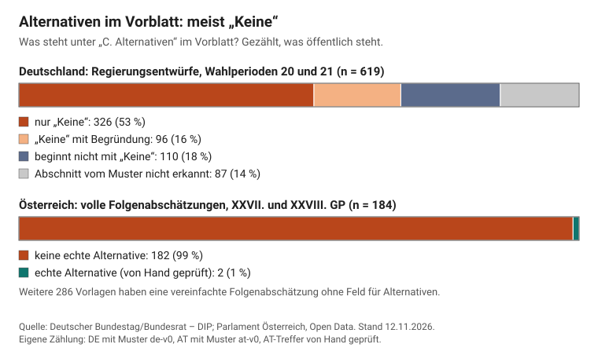

# Open Policy Navigator

Arbeitstitel. Hervorgegangen aus der Zählung „Keine Alternative“.

Offene Bausteine, mit denen sich politische Lösungsansätze, Befunde und Gegenpositionen belegt erfassen und maschinell abfragen lassen. Ausgangspunkt ist eine Zählung: Wie oft nennen Gesetzentwürfe im Vorblatt eine Alternative? Dieses Repository enthält die ersten Zählskripte für den Deutschen Bundestag und den österreichischen Nationalrat, die Rohdaten der Zählung und deren Grenzen.

Hintergrund und Stand der Forschung: [docs/background.md](docs/background.md). Architektur, Parser, Prüfschleife und Datenmodell in Bildern: [docs/architecture.md](docs/architecture.md). Öffentliche Demo des Vergleichsportals: [smarqart-hash.github.io/open-policy-navigator](https://smarqart-hash.github.io/open-policy-navigator/).



Status: Vorarbeit. Die Zählung ist ein kleines, getestetes Python-Paket (`src/open_policy_navigator/`); ein von Hand geprüftes Goldset (36 Entwürfe, gegen die PDFs abgeglichen) und ein Eval-Ratchet in der CI verhindern Rückschritte bei der Abschnittserkennung. Das Datenschema v0 (Lösungsansatz, Fall, Befund, Position, Quelle) und der Antwortvertrag für einen MCP-Server liegen als Entwurf mit Tests vor. Parser-Ausbau, kuratierte Einträge, API und MCP-Server sind geplant, aber noch nicht gebaut.

## Aufbau

| Ordner | Inhalt |
|---|---|
| `src/open_policy_navigator/` | Abruf, Extraktion, Klassifikation, Auswertung (DE, AT); Schema; Antwortvertrag |
| `zaehlung/` | Daten der Zählung (jsonl) |
| `tests/` | pytest, Fixtures aus echten Vorblättern |
| `eval/` | Goldset und Schwellenwerte (Eval-Ratchet) |
| `schema/` | exportiertes JSON Schema und Beispiele |
| `contracts/mcp/` | Antwortvertrag des geplanten MCP-Servers mit Golden-Tests |
| `docs/` | Hintergrund, Architektur in Bildern, Grafiken (`docs/figures/`, aus den Daten erzeugt), Architekturentscheidungen (`docs/adr/`) |

## Ergebnisse (Stand 12. November 2026)

**Deutschland.** Die Gemeinsame Geschäftsordnung der Bundesministerien sieht für Gesetzentwürfe der Bundesregierung ein Vorblatt mit dem Abschnitt „C. Alternativen“ vor (§ 42 Abs. 1 GGO mit Anlage 3). Ausgewertet wurden 1.083 Gesetzentwürfe der Wahlperioden 20 und 21 über die DIP-API.

| Urheber | Abschnitt erkannt | nur „Keine“ | „Keine“ mit Begründung | Alternative benannt |
|---|---|---|---|---|
| Bundesregierung WP 20 | 298 | 187 | 53 | 58 |
| Bundesregierung WP 21 | 234 | 139 | 43 | 52 |
| Fraktionen WP 20+21 | 328 | 220 | 31 | 77 |
| Bundesrat WP 20+21 | 89 | 55 | 4 | 30 |

Bei 326 von 619 Regierungsentwürfen steht nur das Wort „Keine“, in 422 der 532 erkannten Abschnitte beginnt er damit. 87 Regierungsentwürfe erkennt das Muster nicht; das Goldset zeigt, dass die meisten davon einen langen Abschnitt C haben. Hochgerechnet haben rund 602 Regierungsentwürfe einen Abschnitt C, bei rund 54 % steht nur „Keine“ ([Hintergrund, Abschnitt 1](docs/background.md)).

**Österreich.** Ausgewertet wurden 496 Regierungsvorlagen des Nationalrats (XXVII. und XXVIII. GP), davon 470 mit Vorblatt und Wirkungsorientierter Folgenabschätzung (WFA). 286 haben eine vereinfachte WFA ohne eigenes Feld für Alternativen. Von 184 vollen WFA nennen 2 eine inhaltliche Alternative zur vorgeschlagenen Regelung (von Hand geprüft).

## Grenzen

- Gemessen wird, was im Vorblatt steht, nicht, ob ein Ministerium Alternativen geprüft hat.
- Deutschland: Einordnung per Muster („beginnt mit Keine“). Die 87 nicht erkannten Regierungsentwürfe sind nicht von Hand geprüft; 20 davon stehen zur Prüfung im Goldset. Das Muster findet Abschnitte über 700 Zeichen nicht, vermutlich eine Hauptursache. Sätze wie „Zu den Änderungen bestehen keine Alternativen.“ zählen nicht als „Keine“. EU-Bezug nur über Stichworte im Titel.
- Österreich: Die Trennung „nur Nullszenario“ und „keine Alternative“ ist musterbasiert und unscharf. Ausgewertet wurden die ersten rund 600 bis 900 Zeichen des Abschnitts.

## Reproduktion

Python 3.12 oder neuer. Für Österreich zusätzlich `pdftotext` (Poppler).

```bash
pip install -e ".[dev]"

# Zahlen aus den gespeicherten Daten nachrechnen (ohne Netz)
python -X utf8 -m open_policy_navigator.de report zaehlung/de/dip-gesetzentwuerfe.jsonl
python -X utf8 -m open_policy_navigator.at report zaehlung/at/at-vorblaetter.jsonl

# Neu abrufen (schreibt nur in eine NEUE Datei, überschreibt nichts)
# Deutschland: API-Schlüssel nur als Umgebungsvariable, nie im Code
DIP_API_KEY=... python -m open_policy_navigator.de fetch 20,21 neu-de.jsonl
python -m open_policy_navigator.at fetch XXVIII,XXVII neu-at.jsonl
python -m open_policy_navigator.at refetch neu-at.jsonl neu-at-2.jsonl
```

Neu abgerufene Datensätze tragen `source_url`, `fetched_at` (UTC), `text_sha256` (SHA-256 des Volltexts) und die Extraktor-Version; in Deutschland zusätzlich die DIP-Kennung `dip_id`. Die Datensätze der ersten Zählung (November 2026) haben diese Felder noch nicht; sie werden beim nächsten Abruf ergänzt.

Einen API-Schlüssel für DIP gibt es beim [Deutschen Bundestag](https://dip.bundestag.de/über-dip/hilfe/api).

## Einsatz von KI-Werkzeugen

Der Code dieses Repositorys entsteht KI-assistiert: Ich (Stefan Marquart) nutze Claude Code als Programmierwerkzeug. Ich lege Ziel, Aufbau und Regeln fest, lasse in kleinen Schritten arbeiten, lese jeden Diff und verantworte jeden Commit; Tests, Goldset und CI prüfen das Ergebnis unabhängig davon, wer eine Zeile geschrieben hat. Commits mit KI-Beteiligung tragen eine `Co-Authored-By`-Zeile.

In der Datenpipeline sind Abruf, Extraktion und Klassifikation regelbasiert. Sprachmodelle dürfen in der Vorprüfung Vorschläge machen, aber nur mit wörtlichem Zitat aus dem archivierten Quelltext, gekennzeichnet als `extraction_method: llm` und `review_status: proposed`. Ein Mensch entscheidet; nichts erscheint ungeprüft als geprüft ([ADR 0005](docs/adr/0005-language-models-as-documented-proposers.md)).

## Lizenzen und Quellen

- Code: [MIT](LICENSE).
- Daten in `zaehlung/de/`: Quelle Deutscher Bundestag/Bundesrat – DIP. Die Datei enthält Auszüge (Titel, Urheber, Abschnitt „C. Alternativen“), keine vollständigen Drucksachen. Es gelten die [Nutzungsbedingungen des DIP](https://dip.bundestag.de/documents/nutzungsbedingungen_dip.pdf).
- Daten in `zaehlung/at/`: Quelle Parlament Österreich, [Open Data](https://www.parlament.gv.at/recherchieren/open-data/) unter CC BY 4.0. Auszüge aus Vorblatt und WFA.
- Eigene Zuordnungen und Zählungen: CC BY 4.0.
- Details je Quelle und was gespeichert wird: [DATA_SOURCES.md](DATA_SOURCES.md). Mitmachen: [CONTRIBUTING.md](CONTRIBUTING.md).
