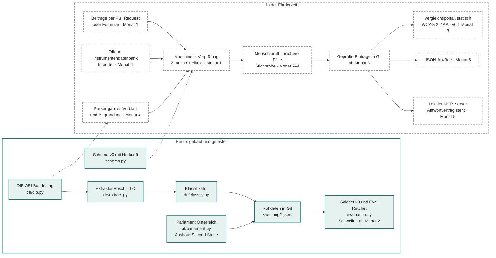
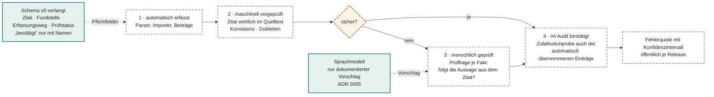
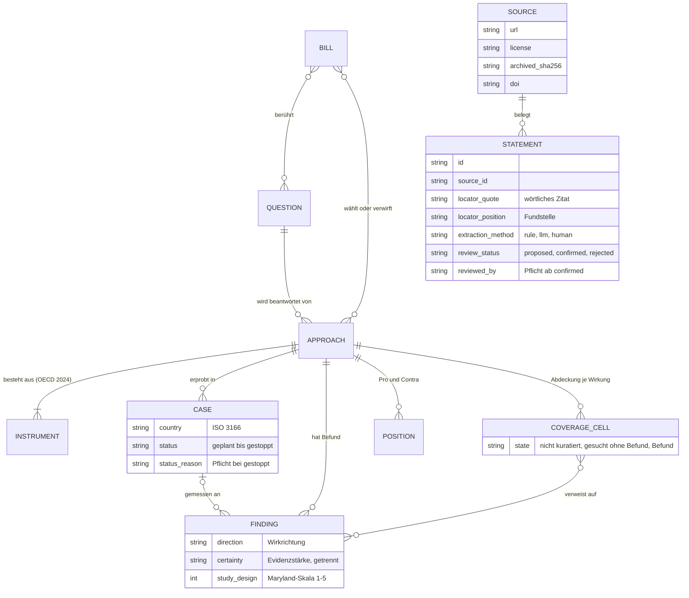
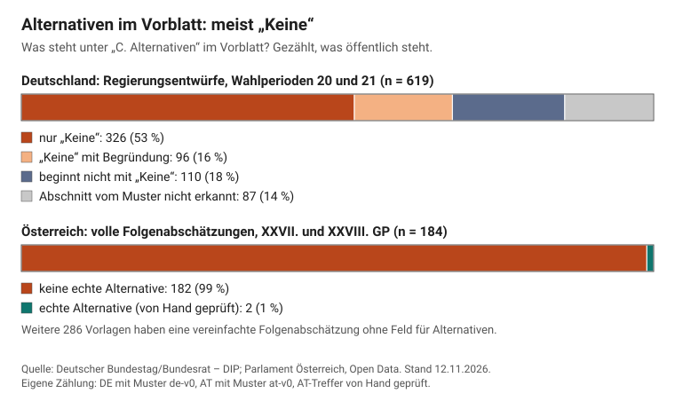
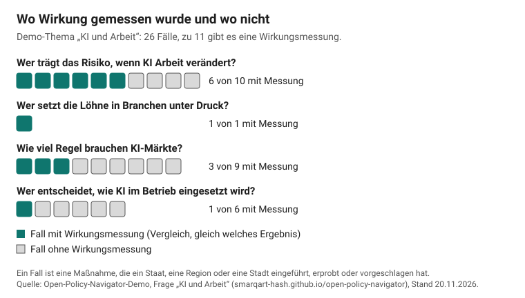
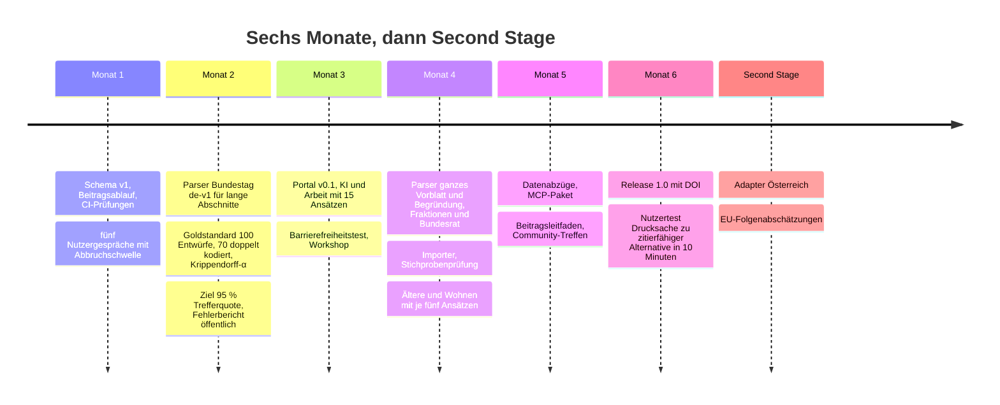

# Architektur in Bildern

Stand: 20.11.2026. Vier Diagramme, zwei Datengrafiken, ein Zeitplan. Jedes Diagramm trennt, was schon gebaut ist, von dem, was in der Förderzeit entsteht:

- **durchgezogener Rahmen**: gebaut und im Repository; `tests/test_figures.py` prüft, dass die genannten Dateien existieren;
- **gestrichelter Rahmen**: geplant, mit Monat aus dem Arbeitsplan.

Unter jedem Diagramm steht eine Textfassung für Screenreader und für alle, die lieber lesen. Fachbegriffe erklärt das [Glossar](#glossar) am Ende.

## 1. Gesamtarchitektur

Textfassung: Heute gebaut ist die Strecke vom Gesetzentwurf zur Zahl. Gesetzentwürfe kommen über die DIP-API des Bundestags (`src/open_policy_navigator/de/dip.py`) und das Parlament Österreich (`src/open_policy_navigator/at/parlament.py`, Ausbau in der Second Stage). Ein regelbasierter Extraktor (`src/open_policy_navigator/de/extract.py`) schneidet den Abschnitt „C. Alternativen“ aus, ein Klassifikator (`src/open_policy_navigator/de/classify.py`) ordnet ihn ein; die Rohdaten liegen als `zaehlung/de/dip-gesetzentwuerfe.jsonl` in Git. Goldset und Eval-Ratchet (`src/open_policy_navigator/evaluation.py`) laufen in der CI, die Schwellen werden aber erst gesetzt, wenn das Goldset von Menschen bestätigt ist (Monat 2). Das Schema v0 (`src/open_policy_navigator/schema.py`, exportiert als `schema/dossier-v0.schema.json`) schreibt für jede Aussage Quelle, Zitat und Prüfstatus vor. In der Förderzeit entstehen Beiträge per Pull Request oder Formular, ein Importer für eine offene Instrumentendatenbank, ein Parser für das ganze Vorblatt und die Begründung, die maschinelle Vorprüfung und die menschliche Prüfung. Aus den geprüften Einträgen baut die CI das Portal (Version 0.1 in Monat 3), JSON-Abzüge und einen lokalen MCP-Server (Monat 5), dessen Antwortvertrag schon steht (`contracts/mcp/answer.schema.json`). Kein Server, keine Nutzerkonten: Git ist die Datenbank ([ADR 0001](adr/0001-git-as-source-of-truth.md)).

## 2. Parser: vom Gesetzentwurf zur Zahl

```mermaid
flowchart TD
    classDef built fill:#e6f2f0,stroke:#0f766e,stroke-width:2px,color:#1f1f1f
    classDef planned fill:#ffffff,stroke:#8a8a8a,stroke-width:2px,stroke-dasharray:6 4,color:#1f1f1f

    A["Abruf über DIP-API<br/>Schlüssel nur aus DIP_API_KEY"]:::built
    B["Datensatz mit Herkunft bei Neuabruf<br/>source_url · fetched_at · text_sha256 · Extraktor-Version"]:::built
    C["Extraktor de-v0<br/>sucht „C. Alternativen“ bis „D.“<br/>in den ersten 20.000 Zeichen"]:::built
    D{"Abschnitt gefunden?"}
    E["Klassifikator<br/>nur „Keine“ · „Keine“ mit Begründung<br/>Status quo · Alternativen"]:::built
    F["kein Abschnitt<br/>87 von 619 Regierungsentwürfen"]:::built
    G["Kodierregel B<br/>Vorschläge eines Sprachmodells<br/>als Vorschlag gekennzeichnet"]:::built
    H["Zufallsstichprobe 50 gezogen<br/>menschliche Prüfung offen"]:::planned
    GS["Goldset v0: 36 Entwürfe<br/>geschichtete Stichprobe plus 3 gesetzte Fälle<br/>5 von Menschen bestätigt"]:::built
    GS2["Goldset 100 Entwürfe<br/>70 doppelt kodiert · Monat 2"]:::planned
    CMP["Vergleich Ergebnis gegen Goldset<br/>Erkennung und Einordnung<br/>evaluation.py"]:::built
    J{"Eval-Ratchet in der CI<br/>Kennzahl unter Schwelle?<br/>Schwellen ab Monat 2"}:::planned
    K["Build bricht ab"]:::planned
    L["Kernzahlen im README<br/>durch Tests an die Daten gebunden"]:::built

    A --> B --> C --> D
    D -- ja --> E
    D -- nein --> F
    E --> L
    E --> G -.-> H
    E --> CMP
    F --> CMP
    GS --> CMP
    GS -.-> GS2
    CMP -.-> J
    J -. ja .-> K
```

Textfassung: Der Abruf über die DIP-API (`src/open_policy_navigator/de/dip.py`) liest den Schlüssel nur aus der Umgebungsvariable `DIP_API_KEY`. Neu abgerufene Datensätze tragen Quelle, Abrufzeit, eine SHA-256-Prüfsumme des Volltexts und die Extraktor-Version (`src/open_policy_navigator/records.py`). Der Extraktor de-v0 sucht „C. Alternativen“ bis zur nächsten Überschrift „D.“; Abschnitte über 700 Zeichen findet er nicht. Von 20 zufällig gezogenen nicht erkannten Regierungsentwürfen hatten 16 einen solchen langen Abschnitt C. Der Klassifikator ordnet gefundene Abschnitte in vier Kategorien; Tests binden die Kernzahlen im README an die gespeicherten Daten (`tests/test_reproduction.py`). Ein Sprachmodell schlägt zusätzlich Kategorien nach Kodierregel B vor (`eval/codebook_b/proposals_government_v0.json`); sie sind als Vorschlag gekennzeichnet, bis ein Mensch eine Zufallsstichprobe von 50 geprüft hat (`eval/codebook_b/sample_v0.json`). Das Goldset (`eval/goldset_v0.json`) umfasst 36 Regierungsentwürfe: 20 zufällig gezogene nicht erkannte, dazu erkannte, geschichtet nach Kategorie, plus 3 gesetzte Fälle; bisher sind 5 von einem Menschen bestätigt. Die Erstauszählung von 2026 hat die Herkunftsfelder noch nicht; sie kommen mit dem nächsten Abruf. Das Skript `src/open_policy_navigator/evaluation.py` vergleicht das Ergebnis mit dem Goldset. Die Schwellen in `eval/thresholds.json` stehen noch auf null; erst wenn das Goldset bestätigt und in Monat 2 auf 100 Entwürfe ausgebaut ist, lässt das Eval-Ratchet den Build scheitern, sobald eine Kennzahl unter ihren bisher besten Wert fällt.

## 3. Prüfschleife: Maschine sortiert vor, Mensch entscheidet

Textfassung: Gebaut ist das Fundament: Das Schema (`src/open_policy_navigator/schema.py`) verlangt für jede Aussage wörtliches Zitat, Fundstelle, Erfassungsweg und Prüfstatus; „bestätigt“ geht nur mit Namen der prüfenden Person. Ebenso festgelegt ist die Regel für Sprachmodelle: Sie dürfen nur dokumentiert vorschlagen ([ADR 0005](adr/0005-language-models-as-documented-proposers.md)). In der Förderzeit entstehen die vier Stufen. Stufe 1 erfasst Einträge über Parser, Importer und Beiträge. Stufe 2 prüft automatisch, ob das Zitat wörtlich im archivierten Quelltext steht, dazu Konsistenz und Dubletten. Unsichere Einträge gehen an Menschen (Stufe 3), die je Fakt prüfen, ob die Aussage aus dem Zitat folgt. Stufe 4 zieht eine Zufallsstichprobe auch aus den automatisch übernommenen Einträgen, weil prüfende Menschen erfahrungsgemäß zu oft zustimmen. Die gemessene Fehlerquote erscheint mit Konfidenzintervall in jedem Release. Belege für das Muster: [Hintergrund, Abschnitt 4a](background.md).

Probelauf von Hand: Für die Demo-Frage „KI und Arbeit“ fand der Abgleich mit den Fundstellen am 20.11.2026 neun fehlerhafte Angaben, die schon öffentlich standen, etwa eine Lohnwirkung von 11 statt 18 Prozent. Die erste unabhängige Prüfrunde fand eine falsch zugeordnete Studie. Nach zwei Runden waren alle schweren Mängel behoben. Genau diese Arbeit soll die Schleife regelmäßig und messbar machen.

## 4. Datenmodell

Textfassung: Eine Frage wird von mehreren Lösungsansätzen beantwortet. Ein Gesetzentwurf (Vorhaben, im Schema `Bill`) berührt Fragen und wählt oder verwirft Ansätze. Ein Ansatz besteht aus einem oder mehreren Instrumenten nach der OECD-Typologie 2024, wurde in Fällen erprobt und hat Befunde und Positionen. Vorhaben, Ansatz, Fall, Befund und Position sind Aussagen (`Statement`): Jede trägt Quelle, wörtliches Zitat, Fundstelle, Erfassungsweg und Prüfstatus. Ein Befund trennt Wirkrichtung und Evidenzstärke. Ein Abdeckungsstatus unterscheidet „nicht kuratiert“, „gesucht, kein Befund“ und „Befund“, damit fehlende Daten nie als „wirkt nicht“ erscheinen. Umgesetzt in `src/open_policy_navigator/schema.py`, exportiert als `schema/dossier-v0.schema.json`, Beispiele in `schema/examples/`.

## 5. Zahlen

Deutschland, 619 Regierungsentwürfe der Wahlperioden 20 und 21: Bei 326 steht unter „C. Alternativen“ nur „Keine“, bei 96 „Keine“ mit Begründung, 110 beginnen anders, 87 erkennt das Muster nicht. „Beginnt anders“ heißt nicht „nennt eine Alternative“: Nach vorläufiger Einordnung nennt nur etwa jeder sechste Entwurf eine konkrete Alternative ([Hintergrund, Abschnitt 1](background.md)). Österreich: Von 184 vollen Folgenabschätzungen nennen 2 eine echte Alternative (von Hand geprüft); weitere 286 Vorlagen haben eine vereinfachte Folgenabschätzung ohne Feld für Alternativen. Erzeugt aus den Daten mit `src/open_policy_navigator/figures.py`.

Demo-Thema „KI und Arbeit“: 26 Fälle in vier Teilfragen, zu 11 gibt es eine Wirkungsmessung (6 von 10, 1 von 1, 3 von 9, 1 von 6). Ein Fall ist eine Maßnahme, die ein Staat, eine Region oder eine Stadt eingeführt, erprobt oder vorgeschlagen hat. Die Lücken sind Absicht: Das Portal zeigt, wo nichts gemessen wurde. Daten: `docs/figures/data/ki-arbeit-wirkungsmessung.json`, übernommen aus der öffentlichen Demo.

## 6. Zeitplan der Förderphase

Textfassung: Monat 1 Schema v1, Beitragsablauf, CI-Prüfungen und fünf Nutzergespräche mit Abbruchschwelle. Monat 2 ein neuer Parser für den Bundestag, der auch lange Abschnitte findet, und ein Goldstandard mit 100 Entwürfen, 70 doppelt kodiert, Übereinstimmung als Krippendorff-α; Ziel 95 Prozent Trefferquote, Fehlerbericht öffentlich. Monat 3 Portal v0.1 mit „KI und Arbeit“, Barrierefreiheitstest, Workshop. Monat 4 Parser für das ganze Vorblatt und die Begründung, auch Entwürfe von Fraktionen und Bundesrat, Importer, Stichprobenprüfung, Themen Ältere und Wohnen mit je fünf Ansätzen. Monat 5 Datenabzüge, MCP-Paket, Beitragsleitfaden, Community-Treffen. Monat 6 Release 1.0 mit DOI und Nutzertest: von der Drucksache zur zitierfähigen Alternative in höchstens zehn Minuten. Danach Second Stage mit dem Adapter Österreich und den Folgenabschätzungen der EU-Kommission.

## Glossar

| Begriff | Bedeutung |
|---|---|
| Vorblatt, „C. Alternativen“ | Deckblatt eines Gesetzentwurfs der Bundesregierung; Abschnitt C soll andere Lösungswege nennen (§ 42 GGO mit Anlage 3) |
| DIP | Dokumentations- und Informationssystem für Parlamentsmaterialien von Bundestag und Bundesrat, mit offener API |
| de-v0, de-v1 | Versionen des deutschen Extraktors; v0 ist das Muster der ersten Zählung, unverändert, damit die Zahlen reproduzierbar bleiben |
| Goldset | Stichprobe mit von Menschen geprüften Antworten, an der die Maschine gemessen wird; Stand v0: 5 von 36 bestätigt |
| Eval-Ratchet | CI-Prüfung, die eine Kennzahl nie unter ihren bisher besten Wert fallen lässt |
| Kodierregel B | Regel, wann ein Abschnitt als „Alternative benannt“ zählt (`eval/README.md`) |
| Krippendorff-α | Maß, wie gut zwei unabhängige Prüfende übereinstimmen; ab 0,800 gilt es als verlässlich |
| WFA | Wirkungsorientierte Folgenabschätzung, das österreichische Gegenstück zum Vorblatt |
| Maryland-Skala | Stufen 1 bis 5 für die Aussagekraft eines Studiendesigns |
| MCP | Model Context Protocol: Schnittstelle, über die KI-Assistenten Daten mit Quellen abfragen können |
| Second Stage | Anschlussförderung des Prototype Fund nach den ersten sechs Monaten |
